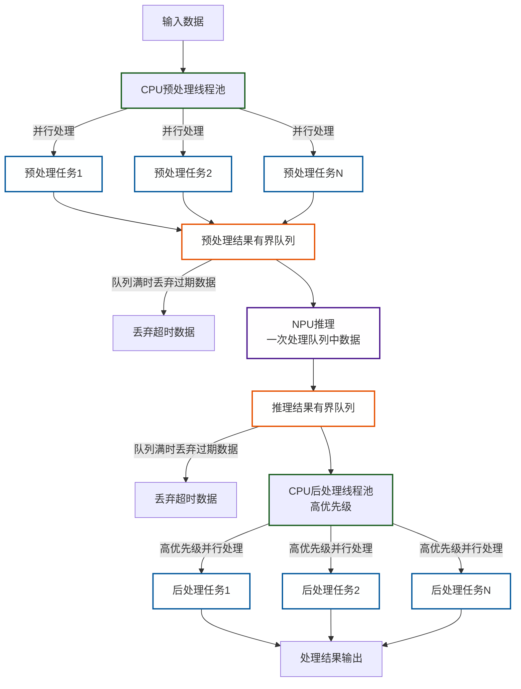

# 算法手册

## 预处理

### 原 PythonAPI 接入分析

- [模型输入](tcp_agent.py.waste#L244) -> `rgb, state, target_point, lidar`
- [rgb](tcp_agent.py.waste#L237) -> `tick_data[rgb]`
- [state](tcp_agent.py.waste#L242) -> `speed, target_point, cmd_one_hot`
  - [speed](tcp_agent.py.waste#L235) -> `tick_data[speed]`
  - [target_point](tcp_agent.py.waste#L239) -> `tick_data[target_point]`
  - [cmd_one_hot](tcp_agent.py.waste#L227) -> `tick_data[next_command]`
  - [tick_data](tcp_agent.py.waste#L215) -> `self.tick(input_data)`
    - `rgb` -> `rgb`
    - `speed` -> `speed`
    - `gps` -> `gps`
    - `lidar` -> `lidar`
    - [target_point](tcp_agent.py.waste#L239) -> [local_command_point](tcp_agent.py.waste#L205) -> `next_wp`,`pos`
      - [next_wp](tcp_agent.py.waste#L195) -> `RoutePlanner.run_step(pos)`
      - [pos](tcp_agent.py.waste#L193) -> `self._get_position(result)`
    - [next_command](tcp_agent.py.waste#L195) -> `RoutePlanner.run_step(pos)`
  - [input_data](/leaderboard/leaderboard/autoagents/autonomous_agent.py#L117) -> [input_data](/leaderboard/leaderboard/autoagents/autonomous_agent.py#L104) -> `sensor_interface.get_data(GameTime.get_frame())`
    - [get_data()](/leaderboard/leaderboard/envs/sensor_interface.py#L234) -> [sensor_data](/leaderboard/leaderboard/envs/sensor_interface.py#L232) -> [self._data_buffers](/leaderboard/leaderboard/envs/sensor_interface.py#L156)

### ros2 topic 列表

/carla/debug_marker
/carla/hero/bev/camera_info
/carla/hero/bev/image
/carla/hero/global_plan
/carla/hero/global_plan_gnss
/carla/hero/gps
/carla/hero/imu
/carla/hero/lidar
/carla/hero/rgb/camera_info
/carla/hero/rgb/image
/carla/hero/speed
/carla/hero/status
/carla/hero/vehicle_control_cmd
/carla/scenario/walker_control_cmd
/carla/status
/carla/world_info
/clock
/parameter_events
/rosout
/tf

## 后处理

### 原 PythonAPI 接入分析

- process_action
  - _get_action_beta
- control_pid

- [steer](tcp_agent.py.waste#L258)
  - [steer_ctrl](tcp_agent.py.waste#L246)
    - process_action
  - [steer_traj](tcp_agent.py.waste#L248)
- [throttle](tcp_agent.py.waste#L259)
- [brake](tcp_agent.py.waste#L260)

## 异步处理设计

- 输入预处理在 CPU 上运行，利用线程池实现多次输入并行处理
- 预处理后的数据放在一个有界队列中，保证时效性
- NPU 推理在 NPU 上运行，一次处理队列中的数据
- 处理结果放在一个有界队列中，等候后处理，保证时效性
- 后处理在 CPU 上运行，利用线程池实现多次后处理并行处理，同时为了提高整体吞吐量，赋予线程更高的处理优先级

